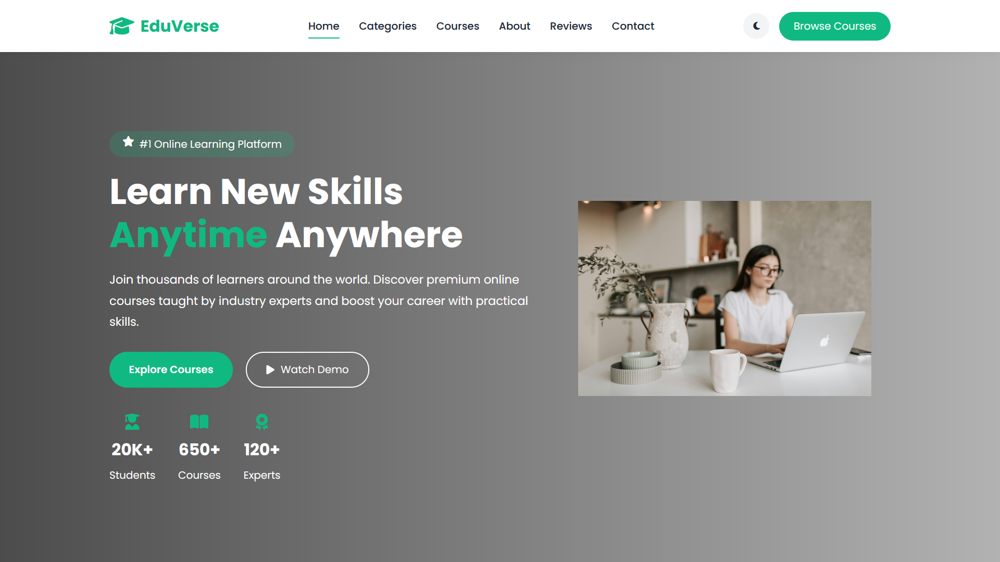
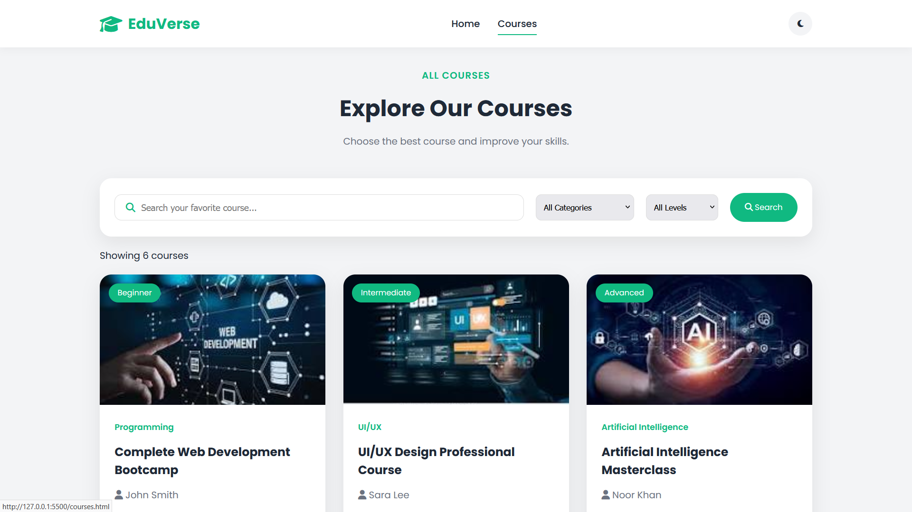
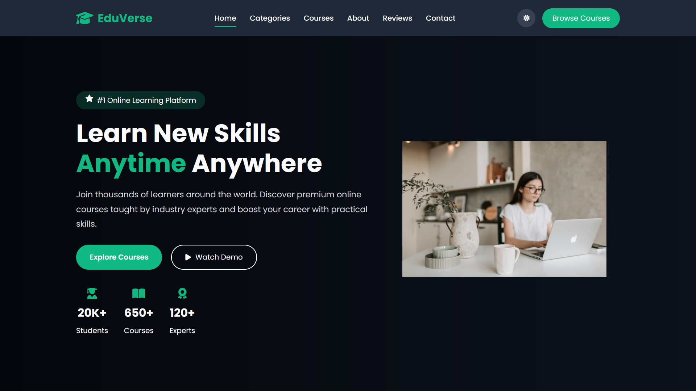

# EduVerse – Online Learning Platform

EduVerse is a modern and responsive online learning platform designed to help learners explore courses, discover new skills, and find learning opportunities across different fields.

The project focuses on providing a clean, user-friendly interface with interactive features and a responsive design that works across desktop, tablet, and mobile devices.

## Features

- **Responsive Design:** Optimized for desktop, tablet, and mobile screens.
- **Dark Mode:** Switch between light and dark themes, with the selected preference saved using LocalStorage.
- **Course Browsing:** Explore available courses through a dedicated courses page.
- **Search & Filtering:** Search courses by title and filter them by category and difficulty level.
- **Favorite Courses:** Add or remove courses from favorites.
- **Interactive Navigation:** Mobile navigation menu and active section highlighting.
- **Animated Statistics:** Dynamic counters for platform statistics.
- **FAQ Accordion:** Expand and collapse frequently asked questions.
- **Newsletter Form:** Basic email validation with interactive feedback.
- **Smooth User Experience:** Loading screen, scroll-to-top button, scroll animations, and toast notifications.

## Technologies Used

- HTML5
- CSS3
- JavaScript (ES6+)
- Font Awesome
- LocalStorage
- Google Fonts

## Project Structure

```text
EduVerse/
│
├── index.html
├── courses.html
│
├── css/
│   ├── style.css
│   ├── responsive.css
│   └── all.min.css
│
├── JS/
│   └── main.js
│
├── asestes/
│   └── Images and other assets
│
└── webfonts/
```

## How to Run the Project

1. Clone the repository:

```bash
git clone YOUR_REPOSITORY_URL
```

2. Navigate to the project folder:

```bash
cd EduVerse
```

3. Open `index.html` in your browser.

You can also use the Live Server extension in Visual Studio Code for local development.

## Important Notes

- This is a front-end project built using HTML, CSS, and JavaScript.
- No backend or database is currently integrated.
- Newsletter subscription and course enrollment interactions are front-end demonstrations.

## Future Improvements

- Integrate a backend and database.
- Implement real user authentication.
- Add functional course enrollment.
- Connect the newsletter form to a real subscription service.

---

## Screenshots

### Homepage


### Courses Page


### Dark Mode


**Developed by Razan Ali**

Computer Science Graduate | Front-End Developer